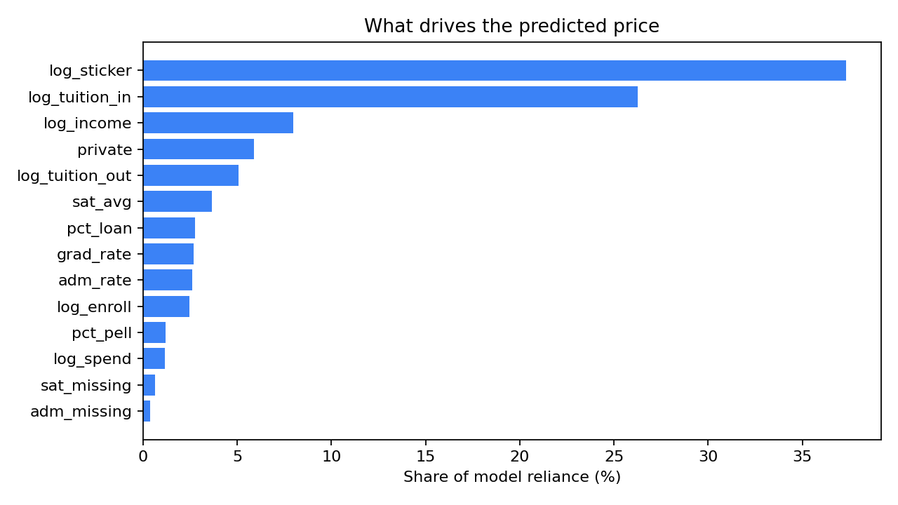

<h1 align="center">💰 TrueCost</h1>

<b>The sticker price is fiction. See what college will really cost you.</b>

An AI tool that predicts the net price of four-year U.S. colleges for your family income, then shows what borrowing would mean for your future paycheck. Prototype, not financial advice.

<a href="https://YOUR-USERNAME.github.io/truecost/">Live Demo</a> ·
<a href="truecost_model.ipynb">Colab Notebook</a>

---

<h2>📖 Overview</h2>

College sticker prices are misleading because most families pay a discounted net price that depends on income. The U.S. Department of Education publishes net price for only five income brackets, and some schools have gaps. TrueCost trains a neural network on that data to estimate net price at any income and for schools with missing or no data, and the model runs live in the browser.

Track: Finance.

<h2>🤖 How AI Is Used</h2>

A neural network (2 hidden layers, 64 and 32 units) predicts log net price from family income and school traits such as sticker price, tuition, admission rate, SAT average, enrollment, share of Pell students, graduation rate, and spending per student. All prices shown in the app come from this model.

<h2>📊 Results</h2>

All results are measured on schools the model never saw. Schools are split into train, calibration, and test sets so no school appears in more than one.

| Model | Average error per year | R² |
|-------|------------------------|----|
| [PASTE YOUR TABLE FROM CELL 5] | | |

The 80 percent price range is calibrated on separate schools. On test schools it contained the true price [PASTE COVERAGE]% of the time.

 

<h2>✨ App Features</h2>

- Personal net price estimates for every school, with an honest range
- Borrowing, monthly payment, and payment-versus-earnings verdicts
- Price-versus-income chart for each school
- Predict any school not in the dataset
- Shortlist and compare, saved in your browser
- A built-in check that the JavaScript model matches the Python model

<h2>⚠️ Limitations and Disclaimer</h2>

This is a prototype and not financial advice. Net prices are averages for students receiving federal aid. The top income bracket is "$110k+", so estimates above that are the least certain. Loan math is simplified: 4 equal years, 10-year repayment at an assumed 6.5 percent, and no interest during school. Earnings are for former federal-aid students 10 years after entry. Always use each college's own net price calculator.

<h2>🧰 Run It Yourself</h2>

1. Download the Most Recent Institution-Level Data CSV from the College Scorecard.
2. Open the notebook in Google Colab and run all cells in order.
3. Put the exported data.js next to index.html and open index.html.

<h2>📚 Credits</h2>

- Data: U.S. Department of Education College Scorecard, https://collegescorecard.ed.gov/data/ (public data)
- Libraries: scikit-learn, pandas, NumPy, Matplotlib; run on Google Colab; hosted on GitHub Pages
- AI tool: Claude (Anthropic) helped write and debug the notebook and website code. I reviewed, tested, and can explain every part.
- Tutorials and pretrained models: none used.

<h2>🆕 What I Added</h2>

[WRITE 2 TO 3 SENTENCES IN YOUR OWN WORDS: what you chose, changed, tested, or fixed.]

---

Built by <b>Nahom Taye</b> for the Veritas AI Hackathon 2026.

