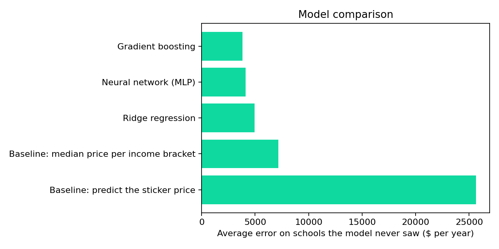
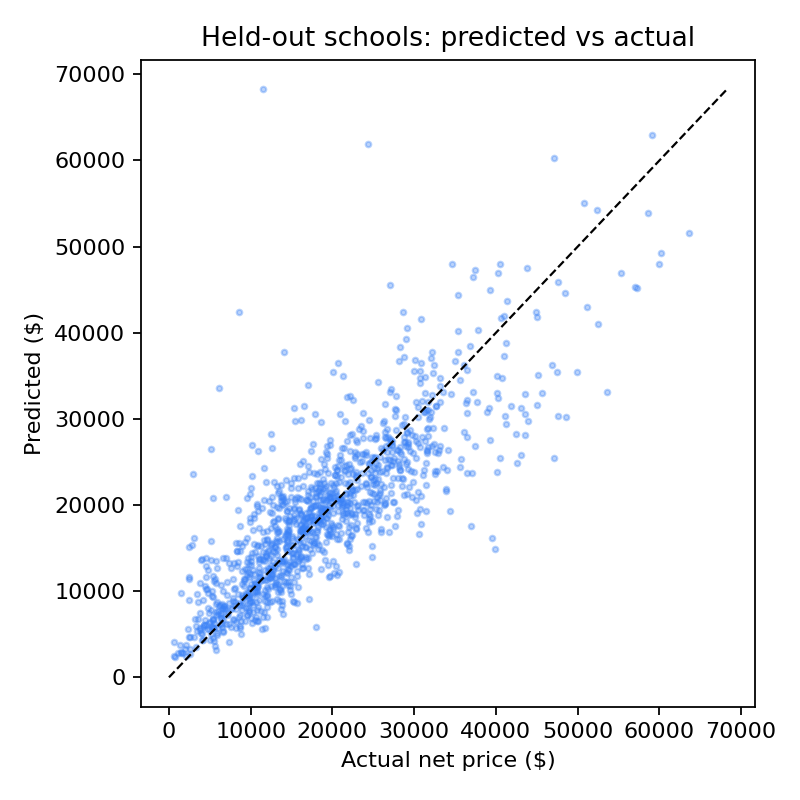

<h1 align="center">💰 TrueCost</h1>

<b>The sticker price is fiction. See what college will really cost you.</b>

An AI tool that predicts the net price of four-year U.S. colleges for your family income, then shows what borrowing would mean for your future paycheck. Prototype, not financial advice.

<a href="https://nt-12354.github.io/Truecost---Nahom-Taye-Belachew---VERSITAS-AI-COMP/">Live Demo</a> ·

---

<h2>📖 Overview</h2>

College sticker prices are misleading because most families pay a discounted net price that depends on income. The U.S. Department of Education publishes net price for only five income brackets, and some schools have gaps. TrueCost trains a neural network on that data to estimate net price at any income, including for schools with missing data or schools not in the dataset. The trained model runs live in the browser, so nothing you type leaves your device.

Track: Finance.

<h2>🤖 How AI Is Used</h2>

A neural network (2 hidden layers, 64 and 32 units) predicts log net price from family income and school traits such as sticker price, tuition, admission rate, SAT average, enrollment, share of Pell students, graduation rate, and spending per student. Every price shown in the app comes from this model. The network was trained in the Colab notebook, and its weights were exported to data.js so the website can run it in plain JavaScript.

<h2>📊 Results</h2>

All results are measured on schools the model never saw. Schools are split into train, calibration, and test sets, so no school appears in more than one set. I compared two baselines and three models.

| Model | Average error per year | R² |
|-------|------------------------|----|
| Gradient boosting | $3,835 | 0.693 |
| Neural network (MLP) | $4,099 | 0.684 |
| Ridge regression | $4,936 | 0.517 |
| Baseline: median price per income bracket | $7,176 | 0.112 |
| Baseline: predict the sticker price | $25,632 | -1.856 |

Key takeaways:
- Gradient boosting had the lowest error, and the neural network was a close second (about $260 a year apart). Both explain roughly 69 percent of the variation in net price and are far more accurate than the baselines.
- Simply guessing the sticker price is off by $25,632 a year on average, with a negative R², which shows how misleading sticker prices are.
- I used the neural network in the app because its weights can be exported and run directly in the browser in plain JavaScript. Gradient boosting was slightly more accurate but cannot be run that way without extra libraries.
- The price range shown in the app was calibrated on separate schools to aim for 80 percent coverage. On test schools it contained the true price 75.4 percent of the time, so it is slightly overconfident and users should treat it as a rough band.
- The raw network does not always predict that price rises with income. 99.6 percent of test-school price curves dip somewhere between $5k and $200k of income, so the app applies a running maximum to keep each curve from going down as income goes up.

  

What drives the prediction: sticker price and in-state tuition are by far the biggest drivers (together over 60 percent of the model's reliance). Family income, school type, and out-of-state tuition come next. On held-out schools, predictions follow the diagonal of perfect accuracy but with real spread, and a few schools are missed by a large amount.

<h2>✨ App Features</h2>

- Personal net price estimates for every school, with an honest range
- Borrowing, monthly payment, and payment-versus-earnings verdicts
- Price-versus-income chart for each school
- Predict any school that is not in the dataset
- Shortlist and compare, saved in your browser
- A built-in check that the JavaScript model matches the Python model

<h2>⚠️ Limitations and Disclaimer</h2>

This is a prototype and not financial advice. Net prices are averages for students receiving federal aid, not a quote for you. The model leans heavily on sticker price and tuition, tends to pull predictions toward the middle (overestimating some low-price schools and underestimating many high-price ones), and has a few large misses, so treat each estimate as a ballpark and use the range shown. The range covered the true price 75.4 percent of the time on test schools, not the full 80 percent it was designed for. Price curves are smoothed with a running maximum because the raw model sometimes predicts a lower price at a higher income. The top income bracket is "$110k+", so estimates above that are the least certain. Loan math is simplified: 4 equal years, 10-year repayment at an assumed 6.5 percent, and no interest during school. Earnings are for former federal-aid students 10 years after entry. Always use each college's own net price calculator and talk to a counselor.

<h2>🧰 Run It Yourself</h2>

1. Download the Most Recent Institution-Level Data CSV from https://collegescorecard.ed.gov/data/
2. Open the Colab notebook, upload the CSV when asked, and choose Runtime, then Run all.
3. Download data.js and put it next to index.html.
4. Open index.html (or use GitHub Pages) to use the app.

<h2>📚 Credits</h2>

- Data: U.S. Department of Education College Scorecard, https://collegescorecard.ed.gov/data/ (public data)
- Libraries: scikit-learn, pandas, NumPy, Matplotlib; trained on Google Colab; hosted on GitHub Pages
- AI tool: Claude (Anthropic) helped write and debug the code. I reviewed, tested, and can explain every part.
- Tutorials and pretrained models: none used.

<h2>🆕 What I Added</h2>

I compared a neural network against gradient boosting, ridge regression, and two simple baselines on schools the models never saw. Gradient boosting scored slightly better ($3,835 vs $4,099 average error), but I chose the neural network for the app because it runs directly in the browser in plain JavaScript with no extra libraries. I ran the full pipeline on the College Scorecard data, checked that the error range covered 75.4 percent of test prices, found that the raw model's price curves were not always increasing with income, kept the running-maximum fix for that in the app, exported the trained weights to the website, and verified that the JavaScript predictions match the Python model.

---

Built by <b>Nahom Taye</b> for the Veritas AI Hackathon 2026.

